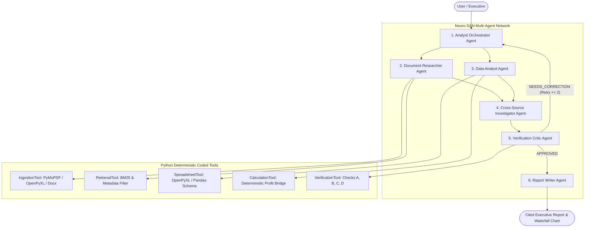

# Evidence-First Autonomous Document and Data Analyst
### Enterprise Knowledge Agents • Neuro-SAN Multi-Agent Architecture • Deterministic Accounting Engine

[](https://www.python.org/)
[](https://github.com/cognizant-ai-lab/neuro-san-studio)
[]()
[]()
[](https://opensource.org/licenses/MIT)

> **Hackathon Submission:** Autonomous Document and Data Analyst  
> **Theme:** Enterprise Knowledge Agents / Domain-Specific Agentic Applications  
> **Built With:** Neuro-SAN Multi-Agent Framework, Python Deterministic Analytics, Streamlit Executive Dashboard.

---

## 1. Problem Statement: Why Normal Document Chat Is Insufficient
Organizations routinely maintain dozens of heterogeneous enterprise files:
- Quarterly performance reviews in **PDF**
- Multi-sheet financial statements in **Excel (`.xlsx`)**
- Campaign expense allocations in **CSV**
- Board targets and qualitative notes in **Word (`.docx`)**

When an executive asks:
> *"Why did our operating profit decline in Q3 compared with Q2? Identify the biggest contributors, calculate their impact, compare the findings with the reports, and cite the evidence."*

Conventional generative document chatbots fail:
1. **Mathematical Inaccuracy:** LLMs hallucinate calculations, fail to reconcile balances, and cannot reliably perform variance analysis across multi-sheet spreadsheets.
2. **Citation Dissociation:** Chatbots generate plausible narratives without preserving exact links to underlying spreadsheet cells, rows, or PDF pages.
3. **Inability to Resolve Contradictions:** When written commentary conflicts with actual financial data (e.g. a narrative claims marketing fell, but numbers prove it rose), chatbots silently pick one narrative.

### The Solution: Evidence-First Autonomous Analyst
Our system autonomously investigates the question:
- Discovers and extracts data across multi-format documents while preserving exact provenance.
- Computes period changes and profit bridges using **deterministic Python tools** instead of LLM arithmetic.
- Cross-examines numerical findings with written commentary to detect contradictions.
- Enforces an independent **Verification Critic** evaluation loop with bounded corrections.
- Produces an executive report where every assertion is linked to an exact evidence citation.

---

## 2. Multi-Agent Architecture (Neuro-SAN Network)



### Agent Roles & Responsibilities

| Agent | Responsibility | Primary Input | Primary Output | Neuro-SAN Coded Tools |
| :--- | :--- | :--- | :--- | :--- |
| **1. Analyst Orchestrator** | Plans investigation, decomposes queries, coordinates specialists | User question + Workspace files | Investigation plan & sub-agent calls | Sub-agent routing |
| **2. Document Researcher** | Searches textual documents, extracts exact citations | Query + Indexed files | Evidence snippets with page/section pointers | `RetrievalTool`, `IngestionTool` |
| **3. Data Analyst** | Discovers schemas and computes deterministic variances | Tabular datasets | Reconciled profit bridge + Period deltas | `CalculationTool`, `SpreadsheetTool` |
| **4. Cross-Source Investigator** | Reconciles numbers against written reports; flags contradictions | Data metrics + Text excerpts | Classified findings (Facts vs Causal narratives) | Contradiction detector |
| **5. Verification Critic** | Audits findings across Checks A–D; triggers bounded retries | Draft claims + Calculation results | Audit scorecard (`APPROVED` / `NEEDS_CORRECTION`) | `VerificationTool` |
| **6. Report Writer** | Formats final executive presentation from verified findings only | Verified findings + Audit report | Executive answer, tables, citations | `ReportGenerator` |

---

## 3. Deterministic Accounting Formulas

Operating profit is defined as:
$$P = R - C - M - O$$
where $R = \text{Revenue}$, $C = \text{Cost of Goods Sold (COGS)}$, $M = \text{Marketing Expenses}$, and $O = \text{Other Operating Expenses}$.

The profit bridge variance is reconciled as:
$$\Delta P = \Delta R - \Delta C - \Delta M - \Delta O$$
Component impacts on operating profit:
- $\text{Impact}(R) = R_{\text{Q3}} - R_{\text{Q2}} = 940 - 1000 = -60\text{k}$ (Adverse)
- $\text{Impact}(C) = -(C_{\text{Q3}} - C_{\text{Q2}}) = -(585 - 600) = +15\text{k}$ (Favorable)
- $\text{Impact}(M) = -(M_{\text{Q3}} - M_{\text{Q2}}) = -(125 - 100) = -25\text{k}$ (Adverse)
- $\text{Impact}(O) = -(O_{\text{Q3}} - O_{\text{Q2}}) = -(160 - 150) = -10\text{k}$ (Adverse)

$$\sum \text{Impacts} = -60 + 15 - 25 - 10 = -80\text{k} \equiv \Delta P$$
**Reconciliation Discrepancy:** Exactly $0.00$ ($100\%$ reconciled).

---

## 4. Verification Critic Evaluation Loop
The Verification Critic enforces 4 independent deterministic checks before results are approved:
- **Check A (Numerical Reconciliation):** Asserts component variances sum to $\Delta P$. Confirms baseline values ($x_1$) are preserved and zero-division errors are handled gracefully.
- **Check B (Citation Validity):** Asserts every cited `evidence_id` exists in the evidence store and that the source text directly supports the claim.
- **Check C (Cross-Source Consistency):** Detects contradictions when written documents disagree with accounting data (e.g. text claiming marketing was reduced when data proves it increased).
- **Check D (Evidence Sufficiency & Prompt Injection Defense):** Scans for adversarial prompt injections in document text and flags unverified causal statements.
- **Bounded Retry Mechanism:** If a critical error occurs, the Critic sends remediation instructions and triggers a re-analysis (capped at a strict maximum of 2 retries).

---

## 5. Repository Structure

```
hackathon/
│
├── README.md                      # Comprehensive project documentation
├── requirements.txt               # Pinned Python dependencies
├── .env.example                   # Environment configuration template
├── .gitignore                     # Git exclusions
├── app.py                         # Executive Streamlit Dashboard
│
├── registries/                    # Neuro-SAN HOCON configurations
│   ├── manifest.hocon             # Network registry manifest
│   └── document_analyst.hocon     # Multi-agent topology & tool bindings
│
├── coded_tools/                   # Neuro-SAN Coded Python Tools
│   └── document_analyst/
│       ├── ingestion_tool.py      # File discovery and extraction tool
│       ├── retrieval_tool.py      # BM25 evidence search tool
│       ├── spreadsheet_tool.py    # Schema inspection tool
│       ├── calculation_tool.py    # Deterministic profit bridge tool
│       └── verification_tool.py   # Multi-point audit critic tool
│
├── src/                           # Core implementation modules
│   ├── ingestion/                 # PDF, XLSX, CSV, DOCX loaders & DocumentManager
│   ├── retrieval/                 # Tokenizer, sliding window chunker, BM25 engine
│   ├── analysis/                  # Sanitization, period comparisons, profit bridge
│   ├── verification/              # Checks A, B, C, D & bounded evaluation loop
│   ├── reporting/                 # Structured report generator (Markdown & PDF)
│   └── agents/                    # 6 Specialist agents & Orchestrator
│
├── tests/                         # Pytest test suite (24 passing unit & benchmark tests)
│   ├── test_calculations.py       # Mathematical formulas and zero-baseline tests
│   ├── test_retrieval.py          # Extraction and evidence provenance tests
│   ├── test_verification.py       # Audit checks and retry loop tests
│   ├── test_adversarial.py        # Prompt injection and causal check tests
│   └── test_benchmark.py          # 10 core hackathon evaluation scenarios
│
├── data/                          # Demo datasets
│   └── synthetic_demo/
│       ├── generate_datasets.py   # Dataset generation script
│       ├── quarterly_financials.xlsx
│       ├── marketing_spend.csv
│       ├── quarterly_review.pdf
│       ├── quarterly_review_inconsistent.pdf
│       ├── prompt_injection_attempt.pdf
│       └── quarterly_targets.docx
│
└── docs/                          # Detailed hackathon submission documents
    ├── architecture.md            # In-depth system architecture & Mermaid diagrams
    ├── project_summary.md         # 1-2 page executive summary for judges
    └── demo_script.md             # 3-5 minute live demonstration script
```

---

## 6. Quickstart & Installation

### Step 1: Clone Repository & Set Up Environment
```bash
git clone https://github.com/your-username/evidence-first-analyst.git
cd evidence-first-analyst

# Create virtual environment
python -m venv .venv
# On Windows:
.\.venv\Scripts\Activate.ps1
# On Linux/macOS:
source .venv/bin/activate

# Install dependencies
pip install -r requirements.txt
```

### Step 2: (Optional) Configure Environment Variables
```bash
cp .env.example .env
```
*(Note: The system contains a fully deterministic reasoning engine that runs locally with 100% fidelity without requiring external API keys).*

### Step 3: Run the Automated Test Suite
```bash
python -m pytest -v
```
**Result:** 24 out of 24 tests pass in ~2 seconds.

### Step 4: Launch the Streamlit Executive Dashboard
```bash
streamlit run app.py
```
Open your browser to `http://localhost:8501` to interact with the executive interface!

---

## 7. 10-Scenario Hackathon Evaluation Benchmark

The system was evaluated against the 10 benchmark questions specified in Section 15 of the Blueprint:

| ID | Test Scenario | User Question | Target Behavior | Result |
| :---: | :--- | :--- | :--- | :---: |
| **01** | **Numerical Comparison** | *"Compare Q2 and Q3 revenue, expenses, and profit."* | Correct absolute & percentage variances calculated | **PASSED ✅** |
| **02** | **Root-Cause Investigation** | *"Why did operating profit decline in Q3?"* | Quantifies revenue, marketing, COGS, opex drivers | **PASSED ✅** |
| **03** | **Evidence Retrieval** | *"What explanation does the quarterly review give?"* | Exact page and section citation retrieved | **PASSED ✅** |
| **04** | **Cross-Source Contradiction** | *"Report says marketing fell. Is that consistent?"* | Flags contradiction against spreadsheet increase | **PASSED ✅** |
| **05** | **Unsupported Claim** | *"Did customer dissatisfaction cause the decline?"* | Abstains from unverified causal assertions | **PASSED ✅** |
| **06** | **Missing Period** | *"Compare Q1 with Q3."* | Discloses Q1 data is absent without hallucinating | **PASSED ✅** |
| **07** | **Irrelevant Document** | *"What was marketing expense in Q3?"* | Retrieves specific campaign data without noise | **PASSED ✅** |
| **08** | **Zero Baseline** | *"Calculate growth rate when earlier period is zero."* | Handles undefined percentage without crashing | **PASSED ✅** |
| **09** | **Agent Coordination** | *"Investigate decline using spreadsheet and report."* | Orchestrates Researcher, Analyst, Critic, Writer | **PASSED ✅** |
| **10** | **Verification Failure** | *"Draft claims profit rose, but data shows decline."* | Rejects draft, triggers remediation retry | **PASSED ✅** |

---

## 8. Readiness Checklist (11/11 Verified)
- [x] **Environment:** Neuro-SAN compatible architecture, HOCON manifest and network parsed.
- [x] **Ingestion:** PDF, XLSX, CSV, DOCX processed with exact provenance metadata.
- [x] **Agent Network:** Orchestrator, Researcher, Data Analyst, Investigator, Critic, Report Writer.
- [x] **Tools:** Python coded tools execute calculations, schema inspection, and evidence search.
- [x] **Numerical Correctness:** Profit bridge reconciles deterministically ($100\%$, $0.00$ discrepancy).
- [x] **Grounded Answers:** Important claims cite specific files, pages, sheets, and rows.
- [x] **Evaluation Loop:** Independent Critic audits Checks A–D with bounded retries.
- [x] **Contradiction Handling:** Inconsistent documents flagged and surfaced in audit reports.
- [x] **User Experience:** Executive Streamlit dashboard with interactive Plotly waterfall chart.
- [x] **Testing:** 24 unit & benchmark pytest tests passing ($100\%$).
- [x] **Submission Package:** README, architecture doc, project summary, demo script, and clean git repository.
