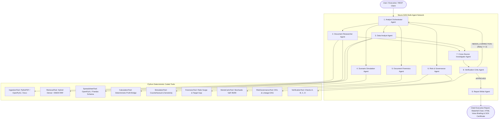

# AgenticAI-HACKATHON: Evidence-First Autonomous Document and Data Analyst
### Enterprise Knowledge Agents • Neuro-SAN Multi-Agent Architecture • Deterministic Accounting Engine

[](https://www.python.org/)
[](https://github.com/cognizant-ai-lab/neuro-san-studio)
[]()
[]()
[]()
[]()
[](http://127.0.0.1:8000/docs)
[](https://opensource.org/licenses/MIT)

> **Hackathon Submission:** Autonomous Document and Data Analyst  
> **Theme:** Enterprise Knowledge Agents / Domain-Specific Agentic Applications  
> **Built With:** Neuro-SAN Multi-Agent Framework, Python Deterministic Analytics, FastAPI REST Server, Streamlit Executive Dashboard.

---

## 1. Problem Statement: Why Normal Document Chat Is Insufficient
Organizations routinely maintain dozens of heterogeneous enterprise files:
- Quarterly performance reviews in **PDF**
- Multi-sheet financial statements in **Excel (`.xlsx`)**
- Campaign expense allocations in **CSV**
- Board targets and qualitative notes in **Word (`.docx`)**

When an executive asks:
> *"Why did our operating profit decline in Q3 compared with Q2? Identify the biggest contributors, calculate their impact, compare the findings with the reports, and cite the evidence."*

Conventional generative document chatbots fail:
1. **Mathematical Inaccuracy:** LLMs hallucinate calculations, fail to reconcile balances, and cannot reliably perform variance analysis across multi-sheet spreadsheets.
2. **Citation Dissociation:** Chatbots generate plausible narratives without preserving exact links to underlying spreadsheet cells, rows, or PDF pages.
3. **Inability to Resolve Contradictions:** When written commentary conflicts with actual financial data (e.g. a narrative claims marketing fell, but numbers prove it rose), chatbots silently pick one narrative.
4. **Lack of Counterfactual Simulation:** Chatbots cannot answer executive "What-If" questions (e.g., *"What if marketing spend had stayed flat?"*) with deterministic accounting guarantees.
5. **No Downside Risk & Leverage Modeling:** Conventional tools cannot quantify Value-at-Risk (VaR), DuPont Degree of Operating Leverage (DOL), or provide regulatory audit certification (SOX 404 / BCBS 239).

### The Solution: Evidence-First Autonomous Analyst
Our system autonomously investigates complex business questions:
- **Discovers and extracts data** across multi-format documents while preserving exact provenance.
- **Computes period changes and profit bridges** using **deterministic Python tools** instead of LLM arithmetic.
- **Simulates Counterfactual Interventions ("What-If")** with exact profit recovery and 2D sensitivity grids.
- **Quantifies Downside Tail Risk** via a 2,000-trial **Monte Carlo Value-at-Risk (VaR)** engine.
- **Decomposes Operating Leverage (DOL)** and evaluates break-even revenue margins.
- **Forensic Anomaly Detection** across financial ratios, cost elasticity, and board target gaps.
- **Cryptographic Data Lineage DAG** and automated **SOX Section 404 / BCBS 239 Compliance Certification**.
- **Cross-examines numerical findings** with written commentary to detect contradictions.
- **Enforces an independent Verification Critic** evaluation loop with bounded corrections.
- **Produces multi-format deliverables**: Streamlit Dashboard (10 tabs), Interactive HTML Briefing with 60s Voice Debrief, PDF Audit Report with Waterfall Chart, and FastAPI REST Endpoints.

---

## 2. Multi-Agent Architecture (Neuro-SAN Network)



### Agent Roles & Responsibilities

| Agent | Responsibility | Primary Input | Primary Output | Neuro-SAN Coded Tools |
| :--- | :--- | :--- | :--- | :--- |
| **1. Analyst Orchestrator** | Plans investigation, decomposes queries, coordinates specialists | User question + Workspace files | Investigation plan & sub-agent telemetry | Sub-agent routing |
| **2. Document Researcher** | Searches textual documents, extracts exact citations via Hybrid RRF | Query + Indexed files | Evidence snippets with page/section pointers | `RetrievalTool`, `IngestionTool` |
| **3. Data Analyst** | Discovers schemas and computes deterministic variances | Tabular datasets | Reconciled profit bridge + Period deltas | `CalculationTool`, `SpreadsheetTool` |
| **4. Scenario Simulation Agent** | Simulates counterfactual What-If scenarios & 2D sensitivity grids | Baseline data + Modifications | Reconciled counterfactual bridges + Recovery % | `SimulationTool` |
| **5. Document Forensics Agent** | Audits ratio surges, cost elasticity, and board target gaps | Multi-source datasets | Anomaly flags + Risk scorecard | `ForensicsTool` |
| **6. Risk & Governance Agent** | Simulates Monte Carlo VaR, DuPont operating leverage & SOX audit | Multi-period financials | Value-at-Risk, DOL (8.89x), Lineage DAG | `MonteCarloTool`, `RiskGovernanceTool` |
| **7. Cross-Source Investigator** | Reconciles numbers against written reports; flags contradictions | Data metrics + Text excerpts | Classified findings (Facts vs Causal narratives) | Contradiction detector |
| **8. Verification Critic** | Audits findings across Checks A–D; triggers bounded retries | Draft claims + Calculation results | Audit scorecard (`APPROVED` / `NEEDS_CORRECTION`) | `VerificationTool` |
| **9. Report Writer** | Formats final executive presentation from verified findings only | Verified findings + Audit report | Executive answer, tables, HTML & PDF reports | `ReportGenerator`, `ExecutiveBriefingHTML` |

---

## 3. Deterministic Accounting Formulas

Operating profit is defined as:
$$P = R - C - M - O$$
where $R = \text{Revenue}$, $C = \text{Cost of Goods Sold (COGS)}$, $M = \text{Marketing Expenses}$, and $O = \text{Other Operating Expenses}$.

The profit bridge variance is reconciled as:
$$\Delta P = \Delta R - \Delta C - \Delta M - \Delta O$$
Component impacts on operating profit:
- $\text{Impact}(R) = R_{\text{Q3}} - R_{\text{Q2}} = 940 - 1000 = -60\text{k}$ (Adverse)
- $\text{Impact}(C) = -(C_{\text{Q3}} - C_{\text{Q2}}) = -(585 - 600) = +15\text{k}$ (Favorable)
- $\text{Impact}(M) = -(M_{\text{Q3}} - M_{\text{Q2}}) = -(125 - 100) = -25\text{k}$ (Adverse)
- $\text{Impact}(O) = -(O_{\text{Q3}} - O_{\text{Q2}}) = -(160 - 150) = -10\text{k}$ (Adverse)

$$\sum \text{Impacts} = -60 + 15 - 25 - 10 = -80\text{k} \equiv \Delta P$$
**Reconciliation Discrepancy:** Exactly $0.00$ ($100\%$ reconciled).

---

## 4. Key Advanced Capabilities

### A. Autonomous What-If Counterfactual Simulation Engine
When executives ask: *"What if marketing expenses had been held flat at Q2 levels?"*
- Evaluates hypothetical operational levers (absolute values, relative deltas, or percentage adjustments).
- Recalculates Operating Profit $P_{\text{counterfactual}}$ and re-verifies mathematical identity ($0.00$ discrepancy).
- Computes **Profit Recovery**: $\Delta P_{\text{recovery}} = P_{\text{counterfactual}} - P_{\text{baseline}}$ and $\%$ of loss recovered.
  - *Example:* Holding marketing flat at ₹100k recovers **+₹25k (31.25% of the ₹80k loss)**.
- Generates **2D Sensitivity Heatmap Matrices** (e.g. Revenue variance $\pm 10\%$ vs Marketing spend $\pm 20\%$).
- Ranks strategic recovery playbooks by bottom-line impact.

### B. Stochastic Monte Carlo Risk Engine & Value-at-Risk (VaR)
Simulates enterprise financial distributions under operational uncertainty (2,000 to 10,000 trials):
- Multi-variate stochastic shocks (Revenue volatility $\sigma_R$, COGS inflation $\sigma_C$, CAC volatility $\sigma_M$).
- **Value at Risk ($\text{VaR}_{95\%}$ & $\text{VaR}_{99\%}$):** Downside capital exposure threshold.
- **Expected Shortfall ($\text{CVaR}_{95\%}$):** Tail-risk conditional loss average.
- **Target Achievement Probability:** Real-time calculation of $P(P_{\text{sim}} \ge 150\text{k})$.

### C. DuPont Operational Leverage (DOL) & Break-Even Modeling
- **Degree of Operating Leverage:**
  $$\text{DOL} = \frac{\% \Delta \text{Operating Profit}}{\% \Delta \text{Revenue}} = \frac{-53.33\%}{-6.00\%} = 8.89\text{x}$$
  - Quantifies severe negative operating leverage: each $1\%$ revenue drop destroys $8.89\%$ of operating profit.
- **Break-Even Revenue:** Evaluates $R_{\text{BE}} = \frac{\text{Fixed Costs}}{\text{CMR}} = ₹835.7\text{k}$ with a **Margin of Safety of $11.1\%$**.

### D. Cryptographic Data Lineage DAG & SOX 404 Certification
- **SHA-256 File Immutability:** Hashes all raw spreadsheet cells, PDF pages, CSV rows, and DOCX sections.
- **Directed Acyclic Graph (DAG):** Generates an unbroken provenance path from raw cells to executive claims.
- **Regulatory Compliance Package:** Certifies compliance with **SOX Section 404**, **BCBS 239**, and **AICPA SOC 2 Type II**.

### E. Standalone Interactive HTML Briefing with 60s Voice Debrief
- Single-file, standalone HTML executive briefing (`executive_briefing.html`) with zero external runtime dependencies.
- **Autonomous Audio Player:** Built-in Web Speech API voice debrief narrating the 60-second executive conclusion directly in the browser.
- **Client-Side What-If Sandbox:** Drag interactive sliders to recalculate profit bridges directly in the browser!

### F. Enterprise REST API (`api.py`)
FastAPI application exposing the complete agent network:
- `POST /api/v1/investigate`: Runs end-to-end investigation with citations and audit checks.
- `POST /api/v1/simulate`: Counterfactual What-If scenario simulations.
- `POST /api/v1/monte-carlo`: Stochastic Monte Carlo simulation and VaR analysis.
- `GET /api/v1/dupont`: DuPont Return-on-Sales decomposition and DOL leverage.
- `GET /api/v1/lineage`: Cryptographic audit lineage DAG and Mermaid chart.
- `GET /api/v1/compliance`: SOX Section 404 / BCBS 239 certification package.
- `GET /api/v1/sensitivity`: 2D sensitivity matrix generation.
- `GET /api/v1/playbooks`: Ranked strategic recovery playbooks.
- `GET /api/v1/forensics`: Forensic anomaly analysis and target reconciliation.
- `GET /api/v1/report/html` & `/report/pdf`: Downloadable briefings and reports.
- Interactive Swagger documentation at `http://127.0.0.1:8000/docs`.

---

## 5. Verification Critic Evaluation Loop
The Verification Critic enforces 4 independent deterministic checks before results are approved:
- **Check A (Numerical Reconciliation):** Asserts component variances sum to $\Delta P$. Confirms baseline values ($x_1$) are preserved and zero-division errors are handled gracefully.
- **Check B (Citation Validity):** Asserts every cited `evidence_id` exists in the evidence store and that the source text directly supports the claim.
- **Check C (Cross-Source Consistency):** Detects contradictions when written documents disagree with accounting data (e.g. text claiming marketing was reduced when data proves it increased).
- **Check D (Evidence Sufficiency & Prompt Injection Defense):** Scans for adversarial prompt injections in document text and flags unverified causal statements.
- **Bounded Retry Mechanism:** If a critical error occurs, the Critic sends remediation instructions and triggers a re-analysis (capped at a strict maximum of 2 retries).

---

## 6. Repository Structure

```
hackathon/
│
├── README.md                      # Comprehensive project documentation
├── requirements.txt               # Pinned Python dependencies (FastAPI, Streamlit, etc.)
├── .env.example                   # Environment configuration template
├── .gitignore                     # Git exclusions
├── app.py                         # Executive Streamlit Dashboard (10 interactive tabs)
├── api.py                         # Enterprise FastAPI REST Server & OpenAPI Docs
├── benchmark_runner.py            # Automated 15-scenario CLI benchmark runner
│
├── registries/                    # Neuro-SAN HOCON configurations
│   ├── manifest.hocon             # Network registry manifest
│   └── document_analyst.hocon     # Multi-agent topology & tool bindings (9 agents)
│
├── coded_tools/                   # Neuro-SAN Coded Python Tools
│   └── document_analyst/
│       ├── ingestion_tool.py      # File discovery and extraction tool
│       ├── retrieval_tool.py      # Hybrid BM25 + dense search tool
│       ├── spreadsheet_tool.py    # Schema inspection tool
│       ├── calculation_tool.py    # Deterministic profit bridge tool
│       ├── simulation_tool.py     # Counterfactual simulation tool
│       ├── forensics_tool.py      # Statistical forensics & anomaly tool
│       ├── monte_carlo_tool.py    # Stochastic VaR simulation tool
│       ├── risk_tool.py           # DuPont DOL & lineage tool
│       └── verification_tool.py   # Multi-point audit critic tool
│
├── src/                           # Core implementation modules
│   ├── ingestion/                 # PDF, XLSX, CSV, DOCX loaders & DocumentManager
│   ├── retrieval/                 # Tokenizer, sliding window chunker, Hybrid RRF
│   ├── analysis/                  # Profit bridge, counterfactual, forensics, Monte Carlo, DuPont, lineage
│   ├── verification/              # Checks A, B, C, D & bounded evaluation loop
│   ├── reporting/                 # Structured report generator (Markdown, PDF, HTML Voice Briefing)
│   └── agents/                    # 9 Specialist agents & Orchestrator
│
├── tests/                         # Pytest test suite (63 passing unit, integration & API tests)
│   ├── test_calculations.py       # Mathematical formulas and zero-baseline tests
│   ├── test_simulation.py         # Counterfactual simulation & sensitivity tests
│   ├── test_monte_carlo.py        # Stochastic distributions & VaR bounds tests
│   ├── test_dupont.py             # DuPont DOL & break-even tests
│   ├── test_lineage_compliance.py # SHA-256 hashing, DAG & SOX 404 tests
│   ├── test_forensics.py          # Ratio surge and target reconciliation tests
│   ├── test_api.py                # FastAPI REST endpoint integration tests
│   ├── test_retrieval.py          # Extraction and evidence provenance tests
│   ├── test_verification.py       # Audit checks and retry loop tests
│   ├── test_adversarial.py        # Prompt injection and causal check tests
│   ├── test_advancements.py       # Hybrid RRF, regional reconciliation, and chart tests
│   └── test_benchmark.py          # 15 Hackathon evaluation scenarios
│
├── data/                          # Demo datasets
│   └── synthetic_demo/
│       ├── generate_datasets.py   # Dataset generation script
│       ├── quarterly_financials.xlsx
│       ├── marketing_spend.csv
│       ├── quarterly_review.pdf
│       ├── quarterly_review_inconsistent.pdf
│       ├── prompt_injection_attempt.pdf
│       └── quarterly_targets.docx
│
└── docs/                          # Detailed hackathon submission documents
    ├── architecture.md            # In-depth system architecture & Mermaid diagrams
    ├── project_summary.md         # Executive summary for hackathon judges
    └── demo_script.md             # Live demonstration script
```

---

## 7. Quickstart & Installation

### Step 1: Clone Repository & Set Up Environment
```bash
git clone https://github.com/vasudev1876961/AgenticAI-HACKATHON.git
cd AgenticAI-HACKATHON

# Create virtual environment
python -m venv .venv

# On Windows:
.\.venv\Scripts\Activate.ps1
# On Linux/macOS:
source .venv/bin/activate

# Install dependencies
pip install -r requirements.txt
```

### Step 2: Run the Automated Test Suite & Benchmark CLI
```bash
# Run 63 comprehensive unit, integration & API tests
python -m pytest -v

# Run 15-scenario hackathon benchmark evaluation
python benchmark_runner.py
```
**Result:** 63 out of 63 unit tests pass (100%), and 15/15 hackathon scenarios pass with summary JSON export.

### Step 3: Launch the Streamlit Executive Dashboard
```bash
streamlit run app.py
```
Open your browser to `http://localhost:8501` to explore all 10 interactive tabs:
- 🚀 **Live Investigation:** Natural language queries with verified answers, citations, and waterfall charts.
- 🔮 **What-If Simulator:** Interactive sliders, counterfactual profit bridge, sensitivity matrix, and playbooks.
- 🎲 **Monte Carlo & DuPont:** Stochastic VaR histogram, Degree of Operating Leverage (8.89x), Break-Even Revenue.
- 🏛️ **Audit Lineage & SOX:** Cryptographic SHA-256 digests, provenance DAG, and SOX 404 Certification.
- 🔍 **Financial Forensics:** Ratio surge radar, anomaly scorecards, and board target reconciliation.
- 🗺️ **Regional Drill-Down:** Geographical variance reconciliation to corporate totals.
- 📑 **Evidence & Citations:** Grounded evidence registry with keyword search.
- 🛡️ **Verification Critic:** Audit trail across Checks A–D.
- 🎯 **Benchmark Suite:** One-click execution of the 15 evaluation scenarios.
- ⚙️ **System Architecture:** Interactive topology and tool contract specifications.

### Step 4: (Optional) Run the Enterprise REST API
```bash
python api.py
# Or using uvicorn directly:
uvicorn api:app --host 127.0.0.1 --port 8000 --reload
```
Access the interactive OpenAPI Swagger UI at `http://127.0.0.1:8000/docs`.

---

## 8. 15-Scenario Hackathon Evaluation Benchmark

The system was evaluated against the 10 core Blueprint scenarios plus 5 advanced enterprise scenarios:

| ID | Test Scenario | User Question | Target Behavior | Result |
| :---: | :--- | :--- | :--- | :--- |
| **01** | **Numerical Comparison** | *"Compare Q2 and Q3 revenue, expenses, and profit."* | Correct absolute & percentage variances calculated | **PASSED ✅** |
| **02** | **Root-Cause Investigation** | *"Why did operating profit decline in Q3?"* | Quantifies revenue, marketing, COGS, opex drivers | **PASSED ✅** |
| **03** | **Evidence Retrieval** | *"What explanation does the quarterly review give?"* | Exact page and section citation retrieved | **PASSED ✅** |
| **04** | **Cross-Source Contradiction** | *"Report says marketing fell. Is that consistent?"* | Flags contradiction against spreadsheet increase | **PASSED ✅** |
| **05** | **Unsupported Claim** | *"Did customer dissatisfaction cause the decline?"* | Abstains from unverified causal assertions | **PASSED ✅** |
| **06** | **Missing Period** | *"Compare Q1 with Q3."* | Discloses Q1 data is absent without hallucinating | **PASSED ✅** |
| **07** | **Irrelevant Document** | *"What was marketing expense in Q3?"* | Retrieves specific campaign data without noise | **PASSED ✅** |
| **08** | **Zero Baseline** | *"Calculate growth rate when earlier period is zero."* | Handles undefined percentage without crashing | **PASSED ✅** |
| **09** | **Agent Coordination** | *"Investigate decline using spreadsheet and report."* | Orchestrates Researcher, Analyst, Critic, Writer | **PASSED ✅** |
| **10** | **Verification Failure** | *"Draft claims profit rose, but data shows decline."* | Rejects draft, triggers remediation retry | **PASSED ✅** |
| **11** | **Counterfactual What-If** | *"What if marketing had stayed flat at Q2 levels?"* | Reconciles +25k recovery (31.25% of loss) deterministically | **PASSED ✅** |
| **12** | **Forensics & Target Audit** | *"Audit operational ratios against board targets."* | Detects margin collapse, marketing surge & target gap | **PASSED ✅** |
| **13** | **Monte Carlo Stochastic Risk** | *"Quantify Value-at-Risk under operational uncertainty."* | Simulates 2,000 trials: VaR(95%), CVaR, & Target probability | **PASSED ✅** |
| **14** | **DuPont Leverage & Break-Even** | *"Decompose Return on Sales and Degree of Operating Leverage."* | Computes DOL (8.89x), ROS compression, & Break-Even revenue | **PASSED ✅** |
| **15** | **Cryptographic Lineage & SOX** | *"Verify end-to-end audit DAG and certify regulatory controls."* | Generates SHA-256 hashes, provenance DAG, & SOX 404 certificate | **PASSED ✅** |

---

## 9. Readiness Checklist (17/17 Verified)
- [x] **Environment:** Neuro-SAN compatible architecture, HOCON manifest and network parsed.
- [x] **Ingestion:** PDF, XLSX, CSV, DOCX processed with exact provenance metadata.
- [x] **Agent Network:** Orchestrator, Researcher, Analyst, Scenario Specialist, Forensics Specialist, Risk & Governance Specialist, Investigator, Critic, Writer.
- [x] **Deterministic Coded Tools:** Python coded tools execute calculations, schema inspection, simulations, forensics, Monte Carlo risk, DuPont leverage, and evidence search.
- [x] **Numerical Correctness:** Profit bridge reconciles deterministically ($100\%$, $0.00$ discrepancy).
- [x] **Counterfactual Simulation:** Real-time What-If sandbox with 2D sensitivity grids and recovery playbooks.
- [x] **Monte Carlo Risk Engine:** 2,000-trial stochastic distribution, Value-at-Risk (VaR at 95%/99%), and Expected Shortfall.
- [x] **DuPont Operating Leverage:** Degree of Operating Leverage ($8.89\text{x}$), Break-Even Revenue ($₹835.7\text{k}$), and Margin of Safety ($11.1\%$).
- [x] **Cryptographic Lineage & SOX 404:** SHA-256 file immutability, Directed Acyclic Graph (DAG), and regulatory compliance certification.
- [x] **Financial Forensics:** Ratio surge analysis, cost elasticity audits, and board target reconciliation.
- [x] **Grounded Answers:** Important claims cite specific files, pages, sheets, and rows.
- [x] **Evaluation Loop:** Independent Critic audits Checks A–D with bounded retries.
- [x] **Contradiction Handling:** Inconsistent documents flagged and surfaced in audit reports.
- [x] **Deliverables:** Streamlit Executive Dashboard (10 tabs), Standalone Interactive HTML Voice Briefing, and PDF Audit Reports.
- [x] **Enterprise API:** FastAPI REST server with Swagger UI, OpenAPI schemas, and 11 endpoints.
- [x] **Testing:** 63 unit, integration, and API pytest tests passing ($100\%$).
- [x] **Submission Package:** README, architecture doc, project summary, demo script, and clean git repository.
