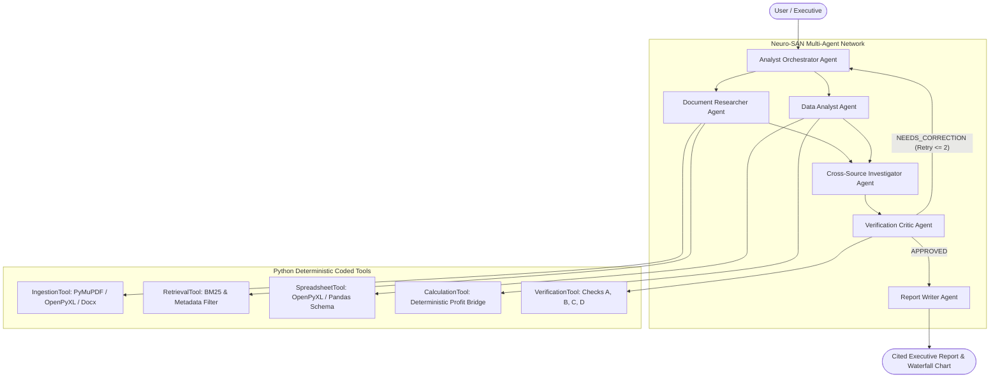

# System Architecture: Evidence-First Autonomous Document and Data Analyst

## 1. Architectural Philosophy
Generic document chatbots rely on generative LLMs to perform both information retrieval and arithmetic calculation. This introduces two fatal flaws:
1. **Mathematical Hallucination**: LLMs frequently make calculation errors when comparing financial periods or aggregating expenses.
2. **Citation Dissociation**: Chatbots generate plausible narratives that blend facts with unverified causal claims without preserving exact source provenance.

Our **Evidence-First Autonomous Document and Data Analyst** decouples qualitative understanding from deterministic computation, orchestrating 6 specialist agents coordinated via the **Neuro-SAN** framework:

---

## 2. Agent Responsibilities & Contracts

| Agent | Responsibility | Inputs | Outputs | Primary Tool Bindings |
| :--- | :--- | :--- | :--- | :--- |
| **1. Analyst Orchestrator** | Plans investigation, decomposes queries, routes sub-tasks, enforces retry limit | User question + Workspace Inventory | Investigation Plan & Specialist Routing | Agent invocation registry |
| **2. Document Researcher** | Searches textual documents, extracts grounded excerpts | Question + File indexes | Evidence records with exact citations | `RetrievalTool`, `IngestionTool` |
| **3. Data Analyst** | Analyzes spreadsheets and computes deterministic variances | Financial metrics + Spreadsheet data | Reconciled profit bridge + Period deltas | `CalculationTool`, `SpreadsheetTool` |
| **4. Cross-Source Investigator** | Reconciles numbers against written reports; isolates contradictions | Numerical metrics + Document excerpts | Classified findings (Facts vs Causal claims) | Cross-referencing logic |
| **5. Verification Critic** | Audits findings across Checks A–D, triggers bounded retries | Draft claims + Calculation results | Audit scorecard (`APPROVED` / `NEEDS_CORRECTION`) | `VerificationTool` |
| **6. Report Writer** | Formats final executive presentation from verified findings only | Verified findings + Audit report | Executive summary, tables, citations | `ReportGenerator` |

---

## 3. Data Flow & Provenance Lifecycle

### Step 1: Ingestion & Provenance Tagging (`src/ingestion/`)
- Multi-format loader ingests PDF, XLSX, CSV, and DOCX files.
- Each extracted item receives a deterministic `evidence_id` (e.g. `EV-001`, `EV-002`) and preserves exact provenance metadata:
  - **PDF**: File name, page number, section header, text snippet.
  - **Excel**: File name, sheet name, row index, column headers, cell range, structured key-value pairs.
  - **CSV**: File name, row index, headers, structured data.
  - **DOCX**: File name, paragraph ID, section title, text.

### Step 2: Search & Retrieval Indexing (`src/retrieval/`)
- Text chunks are indexed using `BM25Okapi` and tokenized with punctuation/currency awareness.
- When `DocumentResearcher` searches, it retrieves top-$k$ evidence records without losing the underlying location pointers.

### Step 3: Deterministic Financial Analysis (`src/analysis/`)
- Pure Python formulas guarantee 100% mathematical accuracy:
  $$\Delta x = x_{\text{Q3}} - x_{\text{Q2}}$$
  $$\%\Delta x = \frac{x_{\text{Q3}} - x_{\text{Q2}}}{x_{\text{Q2}}} \times 100$$
- If baseline $x_{\text{Q2}} = 0$, the system documents an **undefined baseline** rather than crashing.
- Operating profit bridge:
  $$P = R - C - M - O$$
  $$\Delta P = \Delta R - \Delta C - \Delta M - \Delta O$$
- Reconciles component impacts:
  - $\text{Impact}(R) = R_{\text{Q3}} - R_{\text{Q2}}$
  - $\text{Impact}(C) = -(C_{\text{Q3}} - C_{\text{Q2}})$
  - $\text{Impact}(M) = -(M_{\text{Q3}} - M_{\text{Q2}})$
  - $\text{Impact}(O) = -(O_{\text{Q3}} - O_{\text{Q2}})$
  - Verified: $\sum \text{Impacts} \equiv \Delta P$.

### Step 4: Verification Critic Audit Loop (`src/verification/`)
Every draft claim passes four strict audit checks:
- **Check A (Numerical Reconciliation)**: Verifies that component variances sum exactly to $\Delta P$. Rejects claims where narrative contradicts calculation.
- **Check B (Citation Validity)**: Verifies that every cited `evidence_id` exists in the evidence store and supports the assertion.
- **Check C (Cross-Source Consistency)**: Scans for conflicts between textual claims (e.g., "marketing expenditure was reduced") and accounting records (e.g., marketing increased by +25k). Surfaces conflicts rather than silently picking one.
- **Check D (Evidence Sufficiency & Prompt Injection Defense)**: Identifies adversarial directives inside document text and flags unsupported causal statements.
- **Bounded Evaluation Loop**: If a critical issue is identified, the Critic returns remediation instructions and triggers a re-analysis (strictly capped at 2 retries).

---

## 4. Neuro-SAN Framework Integration
- **HOCON Manifest** (`registries/manifest.hocon`): Declares the agent network, entry agents, and metadata tags.
- **Network Configuration** (`registries/document_analyst.hocon`): Declares agent roles, parent-child hierarchies, tool classes, and model parameters.
- **Coded Tools** (`coded_tools/document_analyst/`): Implements Python tool classes connected to the agents according to the Neuro-SAN specification.
